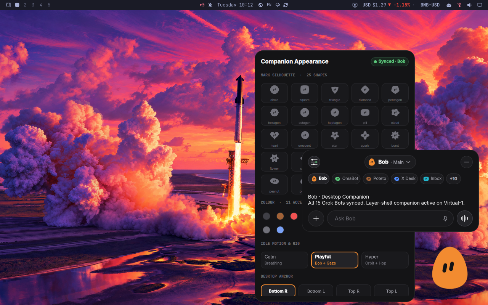

<h1 align="center">Grok Bot Desktop Companion</h1>

<p align="center">A floating Grok Bot companion for the Omarchy desktop. It morphs into your bots and asks them from a speech bubble.</p>

<p align="center"><a href="https://github.com/tcballard/omarchy-badges"></a></p>

**Inspired by [Clippy for Omarchy](https://github.com/jankeesvw/omarchy-clippy) and [Clanky](https://github.com/rdoupe/omarchy-clanky).** The layer-shell window, click-through mask, dodge behaviour, cursor helper, and speech-bubble IPC follow those companions. Plugin conventions come from [Build Omarchy Plugins](https://github.com/tcballard/build-omarchy-plugins).



**Preview:** `preview.png` and [the 70-second demo](assets/grokbot-companion-demo.mp4) are from a live Try Omarchy session on `Virtual-1` at 1280×800 (69.57s, 30fps H.264, 2026-10-27, commit `a8a5d0b`). `tools/render-preview.py` can still redraw the chrome offline. It is not the source of this preview.

## Install

Intended for Omarchy 4 (Quattro) on Hyprland. A live session on Try Omarchy (`Virtual-1`, 1280×800) is recorded in [acceptance evidence](docs/ACCEPTANCE.json). The command to try, once you have reviewed the code, is:

```bash
omarchy plugin add https://github.com/tcballard/omarchy-plugin-grokbot-desktop --enable
```

Optional launcher and close helper. Nothing copies these for you:

```bash
cp grokbot-desktop.desktop ~/.local/share/applications/
cp assets/grokbot-desktop.svg ~/.local/share/icons/hicolor/scalable/apps/io.github.tcballard.grokbot-desktop.svg
cp grokbot-desktop-close ~/.local/bin/
```

```lua
-- ~/.config/hypr/bindings.lua, only if you want Super+W to dismiss the bubble first
hl.unbind("SUPER + W")
o.bind("SUPER + W", "Close window / Grok Bot", "grokbot-desktop-close")
```

A shortcut to show and hide the companion. Super+Alt+B is free in Omarchy's own bindings; pick another if you use it:

```lua
-- ~/.config/hypr/bindings.lua
o.bind("SUPER + ALT + B", "Show or hide Grok Bot", "omarchy-shell io.github.tcballard.grokbot-desktop toggleVisible")
```

## Use

The companion sits in a corner. Clicks outside the mark pass through, and they keep passing through while the bubble is open, so you can work beside a reply. Close the bubble with its minimize button, Esc, or a click on the mark. Drag the mark anywhere on the screen; where you drop it is written back to its own `plugins[]` entry, as margins from the corner chosen on the appearance page. That corner also decides which way the bubble and the menu open first. Hold Super to move it without opening the bubble: the drag starts as soon as you press, and letting go never opens the bubble. Without Super, the drag starts once the pointer has moved a few pixels, and a click opens the bubble. The sliders button in the bubble, Right-click > Appearance & bots, or `settings` crossfades the bubble to its appearance page. The back chevron returns to the chat. The appearance page is laid out like Grok Bot's avatar picker: its fourteen shapes in the chosen colour with a ring around the current one, its eleven colours plus the Omarchy theme accent, and Reset to default, which goes back to the bot's own look.

| Action | Result |
| --- | --- |
| Click, `summon`, or `toggle` | Opens the speech bubble |
| `+`, Ctrl+V, or dropping files on the bubble | Attaches files: `+` offers "Paste image" or "Choose a file…" (Omarchy's file chooser, `omarchy-file-select`; the bubble steps aside while it is open), Ctrl+V attaches a copied image and pastes text as usual otherwise, and any file can be dropped on the bubble. Up to four files, 25 MB each, wait above the field (images as thumbnails, other files by name) and go with the next ask; an ask can be attachments alone. In agent mode the agent is pointed at them (Codex gets `--image` for images); the webhook cannot take attachments yet |
| Enter, or the send arrow (the waveform button turns into it once you type) | Sends the prompt. A leading "Hey <Bot>" selects that bot first. Long prompts wrap and the field grows to six lines before it scrolls; Shift+Enter starts a new line |
| Waveform button on an empty field | Focuses the field and toggles Superwhisper or Voxtype |
| Stop button while asking | Cancels the ask in flight |
| Right-click > Clear conversation, or `clear` | Clears the conversation with the bot on screen; an Undo chip offers it back for 8 seconds |
| Right-click > Hide companion | Hides the companion. A notification says it is hidden, and clicking it brings it back. `show`, `summon`, `toggle`, and `toggleVisible` bring it back too, as does restarting the shell |
| Escape | Steps back: closes the menu, then leaves the appearance page, then closes the bubble |
| Tab, then Enter or Space | Moves between the bubble's controls and presses the focused one |
| Switch Bot | Morphs into that Bot's shape and colour when sync is on, and routes the next ask there. Each bot keeps its own conversation, as a scrolling history of up to 40 exchanges, and its unsent draft for the session (never written to disk); a reply to a bot you have switched away from waits in its conversation with a dot on its chip. One ask runs at a time. Before a conversation the bots sit in a row under the header; once one starts the row folds away and the header pill (the bot's name and chevron; its role slides out on hover) is the switch button, which unfolds every bot until you pick one |
| Pointer nearby, dodge on | Fades the closer the pointer gets (down to 28%) and lets clicks through. Rest on the mark and it fades back in over about 0.4s, then takes clicks |
| Pointer idle for 2 minutes | The capsule eyes close into lid lines |

Bob (`e0195a7d-f804-4688-9191-e2cf3574a6d1`, teardrop, orange) is the default. Asking Bob sends Bob's id, so a Grok Bot routine named for the Omarchy desktop companion can delegate to the other bots. This plugin only delivers the payload.

## IPC

```bash
omarchy-shell io.github.tcballard.grokbot-desktop summon
omarchy-shell io.github.tcballard.grokbot-desktop toggle
omarchy-shell io.github.tcballard.grokbot-desktop hide
omarchy-shell io.github.tcballard.grokbot-desktop toggleVisible
omarchy-shell io.github.tcballard.grokbot-desktop show
omarchy-shell io.github.tcballard.grokbot-desktop settings
omarchy-shell io.github.tcballard.grokbot-desktop clear
omarchy-shell io.github.tcballard.grokbot-desktop ask "What's on my calendar?"
omarchy-shell io.github.tcballard.grokbot-desktop bot "OmaBot"
omarchy-shell io.github.tcballard.grokbot-desktop appearance hex green
omarchy-shell io.github.tcballard.grokbot-desktop animate hop
omarchy-shell io.github.tcballard.grokbot-desktop say "Bob" "Morning briefing is ready."
omarchy-shell io.github.tcballard.grokbot-desktop sayLink "PR Merged" "omarchy-spaces #27 merged." "Open PR" "https://github.com/tornikegomareli/omarchy-spaces/pull/27"
```

`animate` accepts `wave`, `think`, `happy`, `celebrate`, `alert`, `sleep`, `hop`, `spin`, and `morph`. `sayLinks` takes a second label and URL. Links must be `https`, or `http` to localhost, with no credentials. A button opens only when you click it.

`bot` accepts an id, a short name (`OmaBot`, `Poteto`, `dr eggbot`), or the full profile name.

```bash
omarchy-shell io.github.tcballard.grokbot-desktop dictate "Hey OmaBot, check the VM"
bin/grokbot-desktop-ctl dictate "Hey Bob, what's on my calendar?"
```

`dictate` understands the same wake phrases as the prompt field. Anything that does not start with one is ignored, so a normal ask still uses `ask`.

## Dictation

The composer's right-hand button changes with the field. With an empty field it shows the waveform: it focuses the field, lights the waveform, and runs `omarchy dictation toggle`. Once you type it becomes a send arrow, and while an ask runs it becomes Stop.

Omarchy reads `~/.config/omarchy/defaults/dictation` and toggles whichever backend you picked, Superwhisper or Voxtype. Superwhisper's own toggle is Alt+Space (`superwhisper record`). Voxtype's is `voxtype record toggle`, also bound to Super+Ctrl+X. If `omarchy` is not on `PATH`, the button calls that backend command directly. Both backends share one wake-phrase router.

Say "Hey Bot", "Hey Bob", "Hey Grok", or "Hey Grok Bot" and the companion asks Bob (`e0195a7d-f804-4688-9191-e2cf3574a6d1`). Say "Hey OmaBot", "Hey Writer", "Hey Inbox Admin", or any other roster short name or full name, and it selects that bot. The wake phrase and a following comma or colon are removed, the bubble opens, and the rest is asked immediately. Submitting "Hey OmaBot check the VM" from the field does the same thing.

Desktop-wide routing is opt-in. The companion does not watch the clipboard on its own.

Voxtype types the transcript unless a post-process filter removes it first. `fallback_on_empty` has to be false, because Voxtype otherwise types the original line when a filter prints nothing:

```toml
[output.post_process]
command = "python3 bin/grokbot-dictation-route --filter"
fallback_on_empty = false
timeout_ms = 5000
```

`bin/grokbot-voice-watch --print-voxtype-hook` prints that block with the installed script path. `bin/grokbot-voice-watch --enable --install-voxtype-hook` appends it only when Voxtype does not already have a post-process command. A wake phrase is sent to the companion and is not typed. Every other transcript is returned unchanged for Voxtype to type, including through wtype. `bin/grokbot-dictation-route --wtype` is the same rule as a wtype wrapper: a wake phrase is routed, other text is typed.

Superwhisper (`superwhisper.service`, transcripts under `~/.local/share/superwhisper`, `~/.config/superwhisper`, and `~/superwhisper/recordings`) and Voxtype (`voxtype.service`) use the same watcher:

```bash
bin/grokbot-voice-watch --enable
```

It routes a new transcript that starts with a wake phrase. It reads the clipboard only during the three seconds after a recording finishes, and only when that text starts with a wake phrase. A copy you make at any other time is left alone. The same line is not routed twice in ten seconds.

## Dispatch

Each ask is one JSON object on the stdin of `bin/grokbot-ask`, launched as `/usr/bin/setpriv` and `/usr/bin/python3 -I`. The prompt is not an argument.

Set `dispatch` to `webhook` or `agent` in `~/.config/omarchy/grokbot-desktop.json`. The same keys on this plugin's `shell.json` entry win when they are present.

Webhook mode POSTs what Grok Bot's "Omarchy desktop companion" routine takes, as Bob describes it: the prompt, the bot to hand it to by name, and where it came from, plus the bot's id:

```json
{ "prompt": "…", "botName": "Bob", "botId": "…", "source": "Omarchy desktop companion (hostname)" }
```

The routine's Sender key goes in both `Authorization: Bearer <key>` and `X-Automation-Key: <key>`. Find the Webhook URL and Sender key in Grok Bot: click Bob the Bot in the chat header, open Routines, then Omarchy desktop companion. The key is read from `~/.config/omarchy/grokbot-webhook.key` (mode `0600`) or from `GROKBOT_WEBHOOK_KEY` in the helper's own environment. The shell does not put that variable on the helper command line. The URL must be `https`, or `http` to localhost. A response with a `reply`, `text`, `message`, or `output` field, or plain text, is shown in the bubble. A webhook that only acknowledges the ask (an empty body, or JSON without those fields, as a routine webhook that starts a run returns) shows "Sent to Bob. The webhook accepted it but sent no reply back." rather than the raw response. An error body such as `{"code":"error","message":"Invalid API key"}` is reported as an error with its message, whatever the HTTP status, never shown as the bot's reply. The routine's URL has the form `https://api2.cursor.sh/automations/webhook/<id>`. It starts a run in Grok Bot; if it answers only with an acknowledgement, the bubble shows "Sent to Bob" and the reply arrives in Grok Bot. A successful call has not yet been recorded from this plugin.

Attached files are private copies under `$XDG_RUNTIME_DIR/grokbot-desktop/attachments`, cleared at logout. Agent mode runs the agent in that directory and names the files in the prompt, so an agent with file tools can open them; how well that works depends on the agent, and only Codex documents an image flag for one-shot use. Webhook mode refuses attachments, since no webhook file format is known.

Agent mode is the fallback. It is your local coding agent answering in the bot's name, not the Grok Bot itself. It reads `~/.config/omarchy/defaults/agent` (or an `agent` key) and can target `grok`, `claude`, `codex`, `opencode`, `gemini`, `copilot`, `crush`, `pi`, or `omp`; any other default is reported rather than swapped for Claude. The prompt goes on stdin, except for Grok, which is run as `grok --no-auto-update -p "<prompt>"` because that is its headless form, so the prompt is visible in the process list while it runs. An agent that Omarchy has only stubbed for install-on-first-run is reported as not installed rather than installed by an ask. When the agent fails, the bubble shows the agent's name and what it printed. A `command` array overrides all of this and still receives the prompt on stdin. Stdout is capped at 64 KiB.

```json
{
  "dispatch": "webhook",
  "webhookUrl": "https://example.invalid/omarchy-desktop-companion"
}
```

```json
{
  "id": "io.github.tcballard.grokbot-desktop",
  "botId": "e0195a7d-f804-4688-9191-e2cf3574a6d1",
  "syncAppearance": true,
  "dodge": true,
  "idleMotion": false,
  "motion": "calm",
  "anchor": "br",
  "size": "medium",
  "marginX": 24,
  "marginY": 24,
  "recentBots": ["e0195a7d-f804-4688-9191-e2cf3574a6d1"]
}
```

`size` may be `small`, `medium`, `large`, or `custom` with `sizePx` from 48 to 320. `motion` is `calm` (the default: the body holds still and does not blink, as Grok Bot's avatars do at rest, while the face turns toward the pointer: the eyes cross the face and shrink as it turns away, and the outline tilts with it, as Grok Bot moves Bob; while an ask runs it looks around as Bob does while "Working…"), `playful` (breathing, a gentle bob, and blinks), or `hyper` (Playful plus an orbit and hops). `idleMotion: true` is the older switch for Playful. When Omarchy's animations are off (`omarchy toggle animations`, which the shell reads as `Style.reduceMotion`), the companion holds still whatever `motion` says: no breathing, bob, orbit, or hops, and morphs and panel changes happen at once. Shells without `Style.reduceMotion` keep the chosen motion. `anchor` is `br`, `bl`, `tr`, or `tl`, and `marginX` / `marginY` are the insets from that corner. `syncAppearance: false` keeps a custom shape and colour while asks still go to the selected Bot. `recentBots` is written by the companion: the bubble pins the primary bot and the three you used most recently, in roster order, and the rest sit behind the `+N` expander. Switching bots while the bubble is closed shows the new bot's name beside the mark for a moment.

## Roster

`data/bots.json` is the bundled roster: ids, names, shapes, and colours from the live export, with descriptions shortened to a public role line. `bin/grokbot-sync` refreshes `~/.config/omarchy/grokbot-bots.json` from a local agents directory (`--from`, `agentsDir`, or `GROKBOT_AGENTS_DIR`). It keeps `id`, `name`, `avatarShape`, `avatarColor`, and a redacted one-line description. The companion watches that file.

## Remove

```bash
omarchy plugin remove io.github.tcballard.grokbot-desktop
```

That removes the plugin checkout and its `shell.json` entry. The companion's runtime Hyprland layer rule, which only stops the compositor animating its own window, is not written to any file and is gone at the next Hyprland reload. It does not delete `~/.config/omarchy/grokbot-desktop.json`, `~/.config/omarchy/grokbot-bots.json`, or `~/.config/omarchy/grokbot-webhook.key`. Hyprland bindings and the copied desktop file stay until you remove them.

## Development

```bash
./tests/run
```

[Build, run and remove](docs/DEVELOPMENT.md) · [Architecture](ARCHITECTURE.md) · [Release process](docs/RELEASE.md) · [Roadmap](docs/ROADMAP.md)

## Compatibility

Intended target: Omarchy 4 / Hyprland. Live session: Try Omarchy on Virtual-1, 1280×800, 2026-10-27. The installed Omarchy version string was not captured.
Portable checks cover structure, the roster, shape morphing, the palette, and the ask and sync helpers. They do not establish live desktop compatibility. The recorded session is in [acceptance evidence](docs/ACCEPTANCE.json).

## Credits

Built from [Build Omarchy Plugins](https://github.com/tcballard/build-omarchy-plugins) guidance and the Omarchy template set. [Sources, inspiration and assets](CREDITS.md).

## Licence

[MIT](LICENSE). Third-party software and media retain their own licences.
